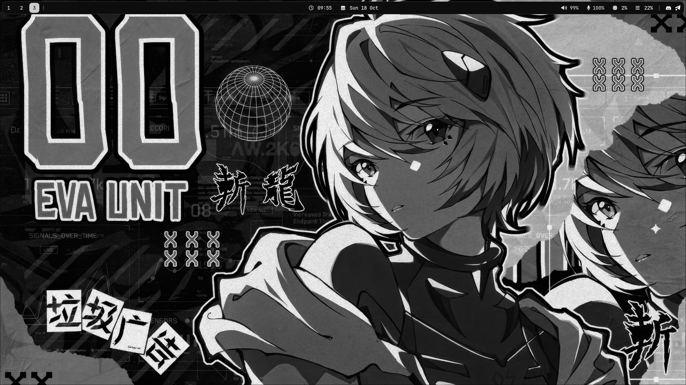
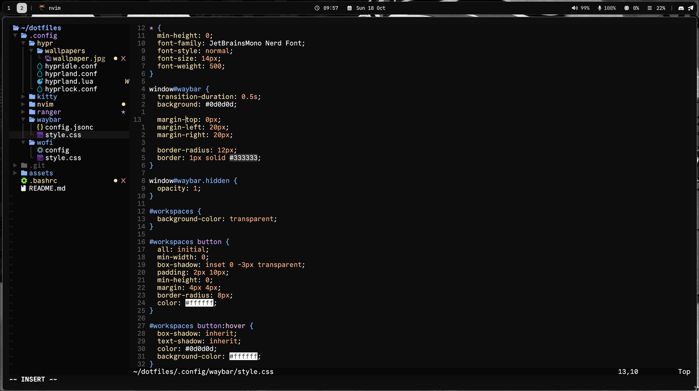

# Dotfiles

Hyprland and Neovim dotfiles

## Screenshots




## Themes

#### ranger icons:

```
git clone https://github.com/alexanderjeurissen/ranger_devicons ~/dotfiles/.config/ranger/plugins/ranger_devicons
```

## Install

**dependencies**: `stow hyprland nvim hypridle hyprlock hyprsunset swaybg ranger waybar wofi kitty hyprpolkitagent sxiv pavucontrol nwg-look grim slurp bash-completion wl-clipboard python-pillow`

### Copy the repository to your home directory

```bash
git clone https://github.com/soirrex/dotfiles.git
```

### Go to the directory and run the stow command

```
cd dotfiles
stow .
```

## Programs

| Component      | Program                                     |
| -------------- | ------------------------------------------- |
| Window manager | [Hyprland](https://hypr.land/)              |
| Shell          | [bash](https://www.gnu.org/software/bash/)  |
| Terminal       | [kitty](https://sw.kovidgoyal.net/kitty/)   |
| File manager   | [ranger](https://github.com/ranger/ranger)  |
| Editor         | [Neovim](https://neovim.io/)                |
| Launcher       | [wofi](https://hg.sr.ht/~scoopta/wofi)      |
| Status bar     | [waybar](https://github.com/Alexays/Waybar) |

## Wallpapers

To change the wallpaper, move the image you want to the `.config/hypr/wallpapers/` folder and rename it to `wallpaper.jpg`

## Hotkeys

### Hyprland

| Hotkey                          | Action                                          |
| ------------------------------- | ----------------------------------------------- |
| `SUPER + r`                     | Open terminal                                   |
| `ALT + q`                       | Close window                                    |
| `SUPER + SHIFT + p`             | Exit                                            |
| `SUPER + e`                     | Open file manager                               |
| `SUPER + w`                     | Toggle floating mode                            |
| `SUPER + v`                     | Open menu                                       |
| `SUPER + u`                     | Toggle split                                    |
| `SUPER + f`                     | Full screen                                     |
| `SUPER + SHIFT + q`             | Exit Hyprland                                   |
| `SUPER + (left,right,up,down)`  | Move focus (left,right,up,down)                 |
| `SUPER + (h,j,k,l)`             | Move focus (left,right,up,down)                 |
| `SUPER + (1..0)`                | Switch workspaces (1..10)                       |
| `SUPER + SHIFT + (1..0)`        | Move active window to a workspace (1..10)       |
| `SUPER + mouse_down`            | Scroll through existing workspaces              |
| `SUPER + mouse_up`              | Scroll through existing workspaces              |
| `SUPER + s`                     | Hyprlock                                        |
| `SUPER + SHIFT + s`             | Create screenshot                               |
| `SUPER + SHIFT + j`             | Open btop                                       |
| `SUPER + mouse_left`            | Move window                                     |
| `SUPER + mouse_right`           | Resize window                                   |

### Ranger

| Hotkey   | Action            |
| -------- | ----------------- |
| `ctrl+h` | Show hidden files |
| `dd`     | Delete            |
| `r`      | Rename            |
| `a`      | Create file       |
| `A`      | Create folder     |
| `y`      | Copy              |
| `p`      | Paste             |
| `m`      | Move              |
| `cc`     | Copy              |
| `cf`     | Copy full path    |
| `cn`     | Copy name         |

### Neovim

#### General

| Hotkey    | Action                        |
| --------- | ----------------------------- |
| `CTRL s`  | Save file                     |
| `Space e` | NeoTree: focus                |
| `Space e` | Show diagnostics under cursor |
| `Space s` | Open image in sxiv            |


#### Tabs

| Hotkey            | Action         |
| ----------------- | -------------- |
| `ALT 1` … `ALT 0` | Go to tab 1–10 |
| `Tab`             | Next tab       |
| `Space w`         | New tab        |
| `Space q`         | Close tab      |
| `ALT h`           | Move tab left  |
| `ALT l`           | Move tab right |

#### Telescope

| Hotkey      | Action                     |
| ----------- | -------------------------- |
| `\ ff` | Find files in project      |
| `\ fw` | Live grep (search text)    |
| `\ fb` | List open buffers          |
| `\ fh` | Help tags                  |
| `\ ls` | Document symbols (LSP)     |
| `\ gr` | References to symbol (LSP) |
| `\ gd` | Definition of symbol (LSP) |

#### Telescope — Git

| Hotkey      | Action             |
| ----------- | ------------------ |
| `Space g b` | Git branches       |
| `Space g c` | Git commit history |
| `Space g s` | Git status         |

#### REST (rest.nvim)

| Hotkey      | Action             |
| ----------- | ------------------ |
| `\ rr` | Run HTTP request   |
| `\ rl` | Run last request   |
| `\ ro` | Open result window |
| `\ rc` | Open cookies       |

#### Autocompletion (nvim-cmp)

| Hotkey       | Action                    |
| ------------ | ------------------------- |
| `CTRL-b`     | Scroll documentation up   |
| `CTRL-f`     | Scroll documentation down |
| `CTRL-Space` | Trigger autocompletion    |
| `CTRL-e`     | Abort autocompletion      |
| `Tab`        | Confirm selected item     |

#### NeoTree (inside its window)

| Hotkey                    | Action                                    |
| ------------------------- | ----------------------------------------- |
| `Space`                   | Toggle node                               |
| `Double Left Mouse` / `o` | Open                                      |
| `Esc`                     | Cancel (close preview or floating window) |
| `P`                       | Toggle preview (floating)                 |
| `l`                       | Focus preview                             |
| `S`                       | Open in split                             |
| `s`                       | Open in vsplit                            |
| `C`                       | Close node                                |
| `z`                       | Close all nodes                           |
| `a`                       | Add file                                  |
| `A`                       | Add directory                             |
| `d`                       | Delete                                    |
| `r`                       | Rename                                    |
| `b`                       | Rename basename                           |
| `y`                       | Copy to clipboard                         |
| `x`                       | Cut to clipboard                          |
| `p`                       | Paste from clipboard                      |
| `c`                       | Copy                                      |
| `m`                       | Move                                      |
| `q`                       | Close window                              |
| `R`                       | Refresh                                   |
| `?`                       | Show help                                 |
| `<`                       | Previous source                           |
| `>`                       | Next source                               |
| `i`                       | Show file details                         |

#### Commenting (nvim-comment)

| Hotkey | Action                         |
| ------ | ------------------------------ |
| `gcc`  | Comment/uncomment current line |
| `gc`   | Comment/uncomment selection    |
